# 🪚 Chainsaw Chat

[](https://github.com/zxcmazokdyrak12/chainsaw-chat/actions/workflows/ci.yml)

> A real-time messenger drawn like a black-and-white manga page, set in the **Chainsaw Man** universe.
> Rooms, voice notes, pictures, video calls, reactions — and you start it by pulling a chainsaw cord.

<p align="center">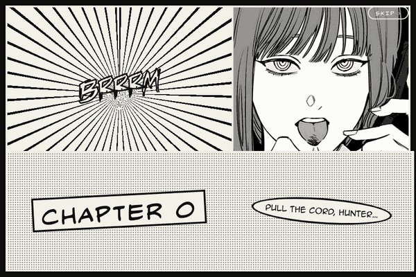</p>

---

## 🖼️ Screens

### 🖥️ Desktop Version

<table width="100%">
  <tr>
    <td width="33.3%" align="center"><b>Start Screen</b></td>
    <td width="33.3%" align="center"><b>Login Screen</b></td>
    <td width="33.3%" align="center"><b>Chat Interface (Manga-Style)</b></td>
  </tr>
  <tr>
    <td>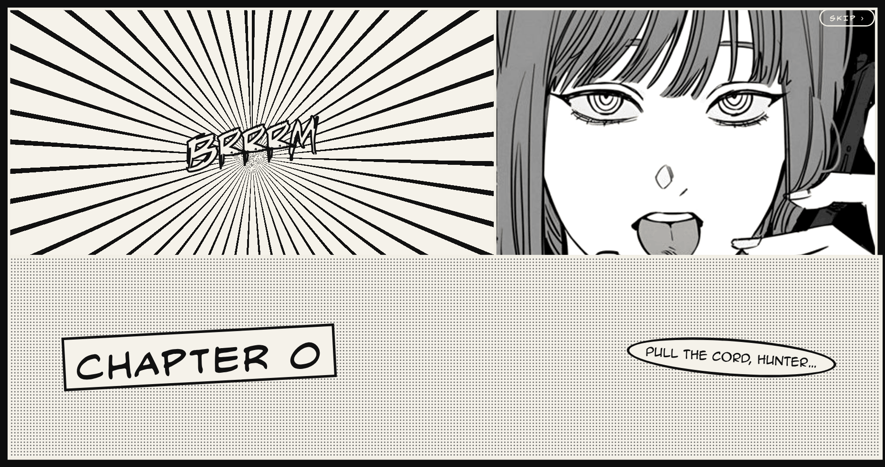</td>
    <td>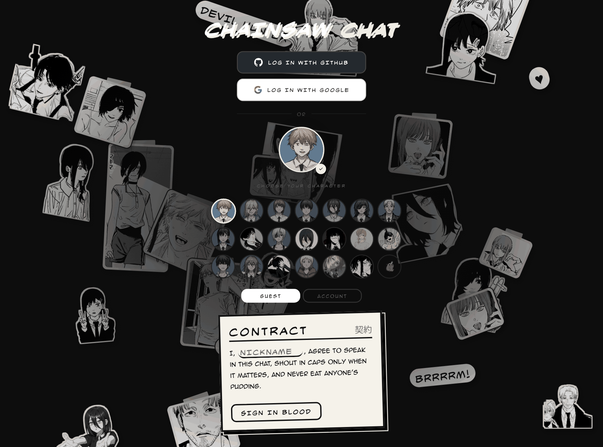</td>
    <td>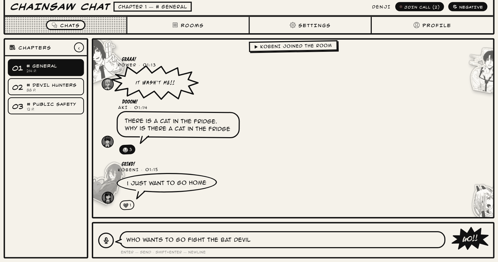</td>
  </tr>
  <tr>
    <td align="center"><b>Rooms Screen</b></td>
    <td align="center"><b>Settings Interface</b></td>
    <td align="center"><b>Profile Screen</b></td>
    <td></td>
  </tr>
  <tr>
    <td>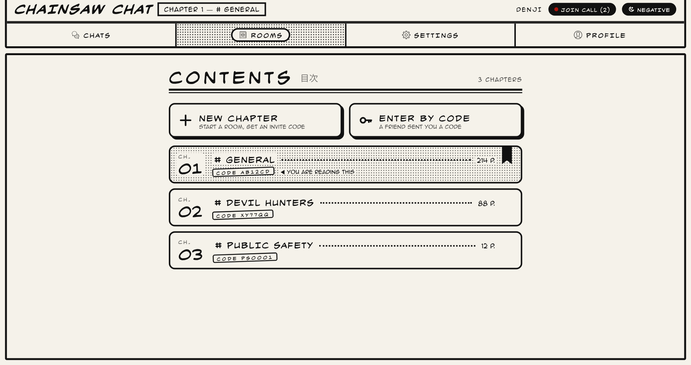</td>
    <td>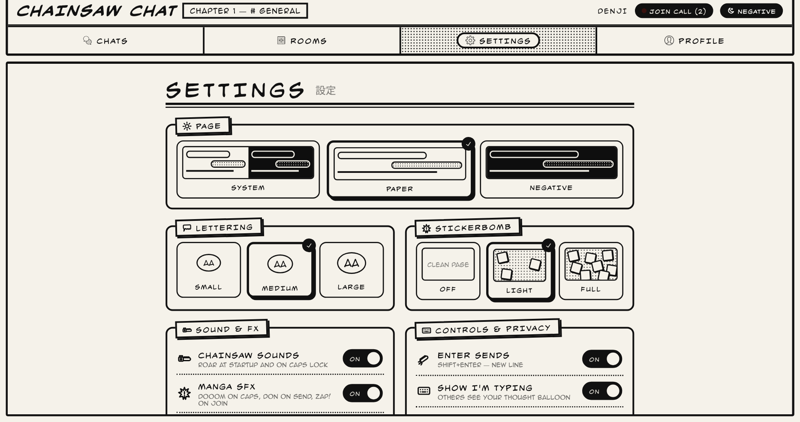</td>
    <td>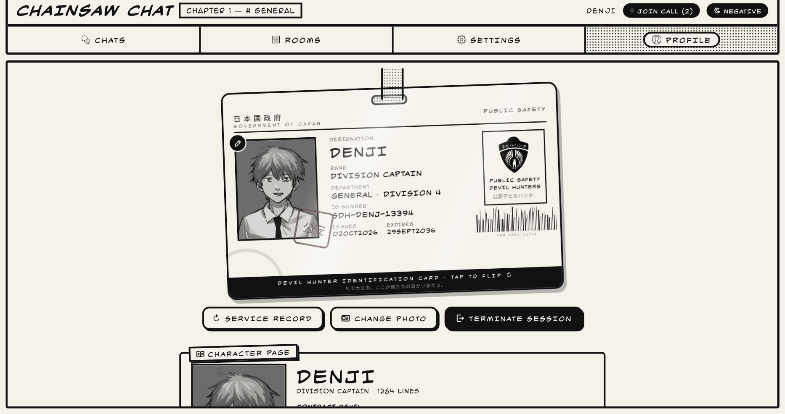</td>
    <td></td>
  </tr>
</table>

---

### 📱 Mobile Version

<table width="100%">
  <tr>
    <td width="25%" align="center"><b>Mobile Chat</b></td>
    <td width="25%" align="center"><b>Mobile Rooms</b></td>
    <td width="25%" align="center"><b>Mobile Settings</b></td>
    <td width="25%" align="center"><b>Mobile Profile</b></td>
  </tr>
  <tr>
    <td>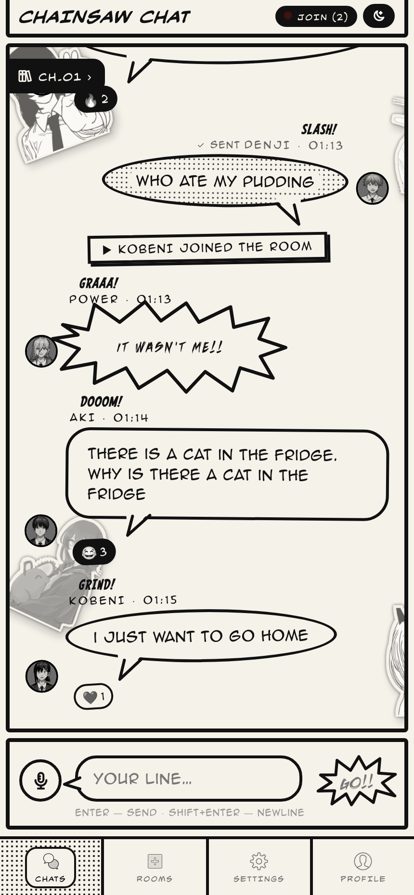</td>
    <td>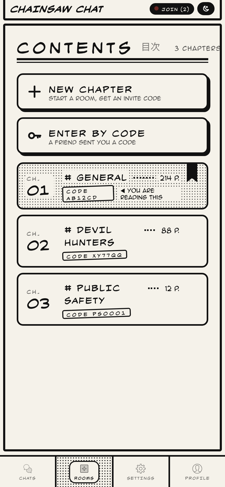</td>
    <td>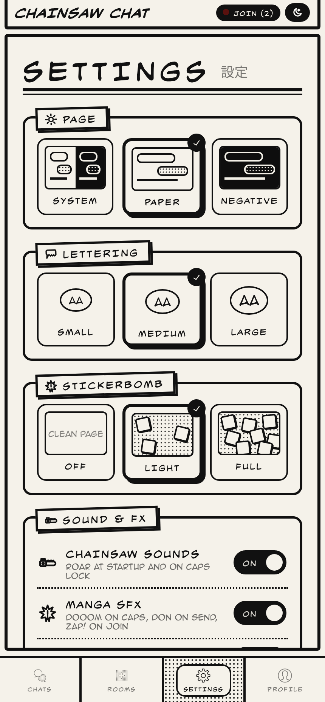</td>
    <td>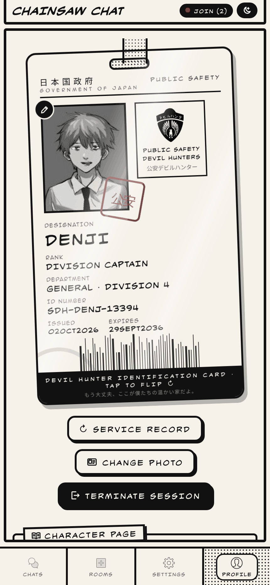</td>
  </tr>
</table>

### 📖 Save a chapter as a manga page

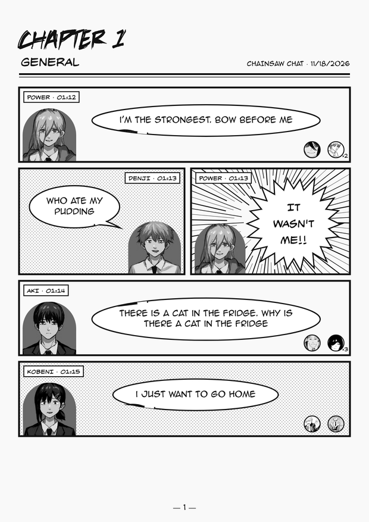

`Alt+E` (or the page icon) lays the chat out again as a real A4 manga page:
- each line becomes a panel, with the speaker's portrait inked in grayscale;
- oval balloons for short lines, a jagged burst for CAPS, screentone and speed lines;
- reaction stickers in the corner;
- spoilers stay blacked out.

It's drawn on canvas by hand, not a screenshot of the UI. One page saves as PNG; a whole chapter becomes a multi-page PDF, written byte by byte without a PDF library.

<br clear="right">

### 🧩 Pictures, replies, commands

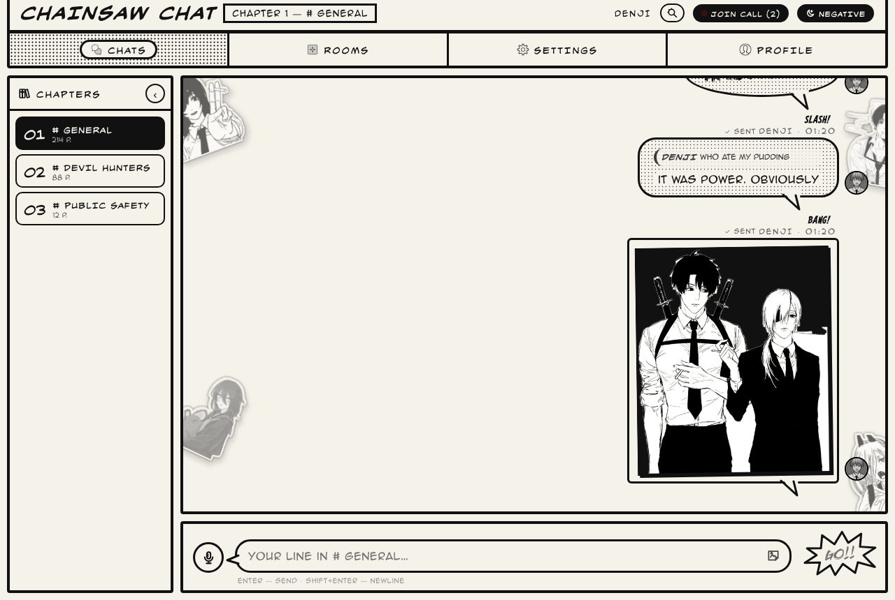

---

## 🏗️ Architecture

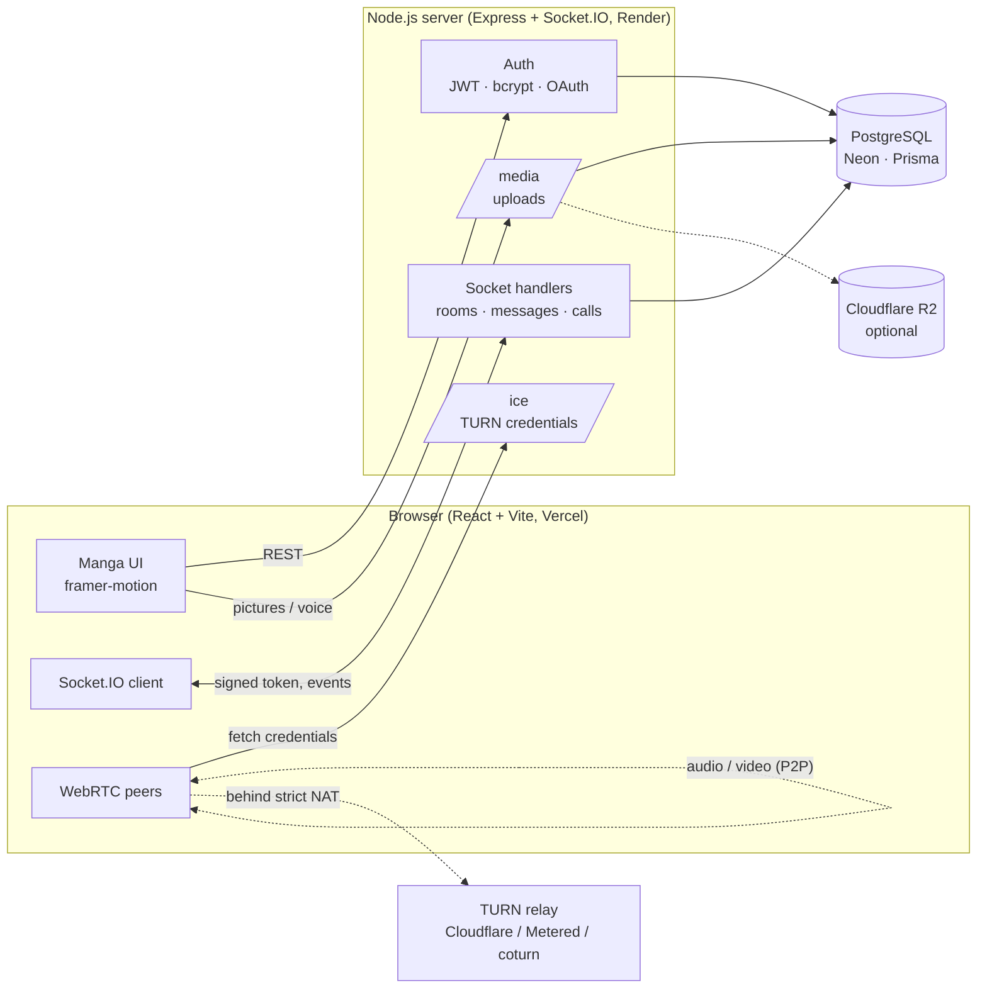

- **Identity is server-side.** Every socket presents a signed JWT on connect. The server takes the username from the token and never from event payloads.
- **Rooms are private by membership.** `general` is the lobby; any other room is reached only through its join code.
- **Media** is checked by magic bytes and stored in Postgres, or in Cloudflare R2 when configured (hand-written SigV4, no AWS SDK). It is served sandboxed under an unguessable id.
- **Calls** are a P2P mesh (up to 4). Socket.IO only relays signaling; `/ice` mints short-lived TURN credentials.

More in [SECURITY.md](SECURITY.md).

---

### Frontend


### Backend & Cloud


---

## ✨ Features

### 🪚 Chapter 0 — the intro
On the first visit, three manga panels slam in. Then a detailed recoil starter appears: pull the T-grip down and let go.
- It sputters twice: two-stroke *put-put*, synthesized live with WebAudio.
- The third pull catches the engine and the cord whips back into the port.
- The screen is cut open diagonally onto the login page.
- Guests sign a **contract** in blood.
- Skippable, keyboard-friendly (Enter / Space), and calm under `prefers-reduced-motion`.

### 💬 Chat
- **Speech balloons**: ovals for short lines, boxes for long ones. CAPS turns a line into a jagged **shout**, and a manga SFX (DOOOM, DON, ZAP!) pops over the feed.
- **Replies** quote the original line; click the quote to jump to it.
- **Pictures**: paste, drag & drop, or the panel button. Shrunk to webp in the browser, shown as a cut-out panel, full-screen on click.
- **Voice notes**: hold the mic.
- **Reactions**: seven hand-picked manga stickers. **✓ SENT → ✓✓ SEEN** read flags. Typing indicator.
- **Search** in the room (`Ctrl+K`): server-side, so older lines are found too; results jump to the line and flash it.
- **Commands** play for the whole room: `/pochita` `/power` `/brrr` `/bang` `/pudding` (`/help` lists them).
- **Contracts & votes**: `/contract Raid the Gun Devil tonight` lets people sign it in blood. `/poll Where do we eat? | Ramen | Pizza` gives one seal per person, with a screentone bar showing the share. Only the author can close it.
- **Spoilers**: `||the twist||` (or `Ctrl+Shift+S` on a selection) hides it behind rough black hatching until clicked. It stays hidden in quotes, search, notifications and exported pages.
- **Berserk mode**: when lines fly in bursts (less than 2 s apart), a tachometer revs up in the corner of the feed: ×4 REV → ×8 BERSERK → ×12 DEVIL MODE, with a synthesized engine rev at each tier and a needle that shivers in the red zone. Can be turned off in Settings.
- **Companions**: a little contract devil peeks over the input bar and reacts to the chat. It dozes after 25 s of quiet, takes a battle stance on CAPS or fast typing, listens while you record a voice note, and panics while the socket is reconnecting. Pick the Ink Imp, the Static Devil (an old TV that turns to snow) or the Seal Devil (a hanko stamp) in Settings, or turn it off. Write *nom* / *ням* and it leans in from the edge and eats the narration boxes. An empty chapter shows the three as parallax silhouettes. All three are original drawings (inline SVG, CSS animations that stop under `prefers-reduced-motion`).
- **Background alerts**: `(3)` in the tab title, a blood-red counter on the favicon, and optional system notifications.

### 💬 A real messenger
- **History pages**: the newest 60 lines first; older pages load as you scroll up. Search results and quotes page back until they find the line.
- **Edit** your lines: EDIT in the menu, `E` on a focused balloon, or `Ctrl+↑`.
- **@mentions**: names show as ink chips, yours inverted, with a red **@YOU** tag and a ping. Typing `@` suggests the room's cast.
- **Room panel** (click the chapter label or `Alt+I`): the cast with online dots, the invite code, and leave. The founder can also rename, kick and delete.

### 📲 Installable, with push
- Add it to the home screen (PWA): manifest, original app icon, offline shell.
- **Push when closed**: notifications even with every tab closed.
  - Web Push is written from scratch: RFC 8291 encryption, tested byte for byte against the RFC's own example, plus RFC 8292 VAPID signing.
  - Private rooms notify every member; the lobby only notifies the people you @mention.
  - Spoilers stay masked on the lock screen.
- **Cold starts**: the free server naps. The page wakes it during the intro, and the login page shows a warm-up gauge. If the connection drops, a banner says so.

### 🌐 English · Русский · 日本語
The interface follows the browser's language and can be switched in Settings. Manga SFX lettering stays as drawn.

### ⌨️ Without a mouse
Press `?` for the full list. The main keys:
- `Alt+1…9` jumps to a chapter (room); `Alt+C/R/S/P` switches tabs.
- `Ctrl+K` searches; `↑` in an empty line replies to the last message.
- Tab to any balloon, then `R` to reply or `Enter` to open its menu (arrow keys, Esc).

The feed is an ARIA live log, and focus is always visible.

### 🚪 Rooms
Create a room and share its code (e.g. `KAIRYU4821`). The chapters drawer lists your rooms like a table of contents.

### 📹 Video calls
WebRTC mesh for up to 4 hunters, each in a manga panel. Mic and camera toggles; falls back to voice-only. TURN relay for strict networks.

### 🪪 Profile
A Public Safety devil-hunter ID that flips over to a service record: lines, shouts, reactions, rank, stamps. Plus a character page others can open from your avatar.

### 🔐 Accounts
- Guest: a signed name that lives for one tab.
- Nickname + password: bcrypt, 8+ characters.
- GitHub or Google OAuth, with `state` and the token returned in the URL fragment.

### ⚙️ Settings
Light / dark / system theme, font size, stickerbomb density, sounds, SFX, Pochita hearts, Enter-to-send, typing privacy, background alerts, and a replayable tour.

---

## 🧪 Tests

```bash
cd server
npm test                    # unit: validation, JWT, magic bytes, SigV4 (AWS doc vector), TURN creds
TEST_DATABASE_URL=postgres://… npm run test:integration
                            # HTTP + Socket.IO + Postgres: impersonation, private rooms, uploads, brute force…
```

```bash
cd e2e && npm install && npx playwright install chromium
DATABASE_URL=postgres://…throwaway… npx playwright test
                            # two real browsers against the real server + production client build
```

All three run on every pull request in [GitHub Actions](.github/workflows/ci.yml), each against a throwaway Postgres.
**Never point `TEST_DATABASE_URL` at the production database** — the tests create users and rooms.

---

## 🚀 Run it locally

```bash
git clone https://github.com/zxcmazokdyrak12/chainsaw-chat.git
cd chainsaw-chat
```

**Server**: copy `server/.env.example` to `server/.env` and fill in at least `DATABASE_URL` and `JWT_SECRET`.

```bash
cd server
npm install
npm run prisma:push      # create / update the tables
npm run dev              # http://localhost:3001
```

**Client**: `client/.env` → `VITE_API_URL="http://localhost:3001"`

```bash
cd client
npm install
npm run dev              # http://localhost:5173
```

Optional env:
- `CF_TURN_KEY_ID` / `CF_TURN_API_TOKEN`: TURN for calls across networks.
- `R2_*`: store uploads in Cloudflare R2 instead of Postgres.
- `VAPID_*`: push notifications; generate them with `npm run vapid:keys`.

See `server/.env.example`.

---

## 📁 Project structure

```text
chainsaw-chat/
├── .github/workflows/ci.yml   ← types, lint, unit + integration + E2E tests, client build
├── e2e/                       ← Playwright: two browsers, real server, real database
├── SECURITY.md                ← threat model and the measures against it
├── server/
│   ├── prisma/schema.prisma   ← users, rooms, messages, attachments, read marks, profiles
│   ├── test/                  ← unit/ and integration/ (node:test)
│   └── src/
│       ├── index.ts           ← wiring: middleware, routes, sockets
│       ├── config.ts          ← env, secrets policy, build tag
│       ├── passport.ts        ← GitHub / Google OAuth
│       ├── lib/               ← tokens, validation, sniffing, storage (DB / R2), SigV4, rooms, polls
│       ├── routes/            ← auth, profile, media, ice, meta
│       └── sockets/           ← auth middleware, rooms, messages, calls, presence
└── client/
    ├── src/
    │   ├── App.tsx            ← screen layout; state lives in hooks
    │   ├── components/        ← intro, balloons, input, search, lightbox, ID card, settings, …
    │   ├── hooks/             ← calls, voice, settings, unread badge, tour, …
    │   └── lib/               ← socket, auth, media, ICE, commands, spoilers, manga page + PDF export
    ├── public/                ← stickers, reactions, avatars, fonts, sounds
    └── vercel.json            ← CSP and security headers
```

---

Created with love for Nayuta and clean code. 🩸

## ⚖️ License & Disclaimer

Chainsaw Chat is a non-commercial fan project made for learning and as a portfolio piece. Characters, artwork references and the original concept belong to Tatsuki Fujimoto and Shueisha / MAPPA.
